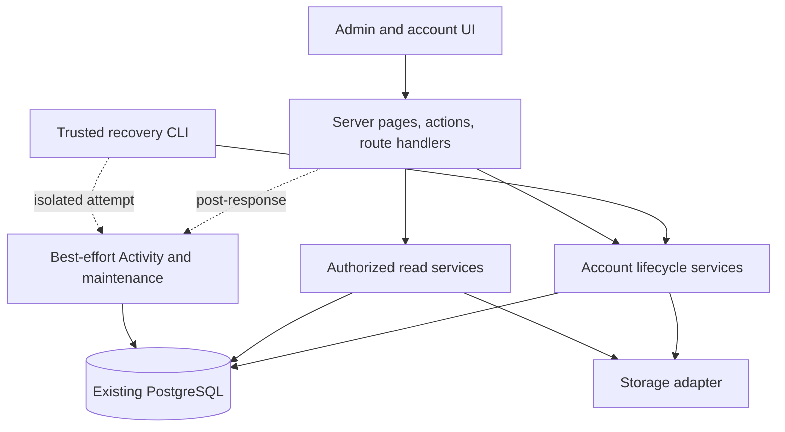
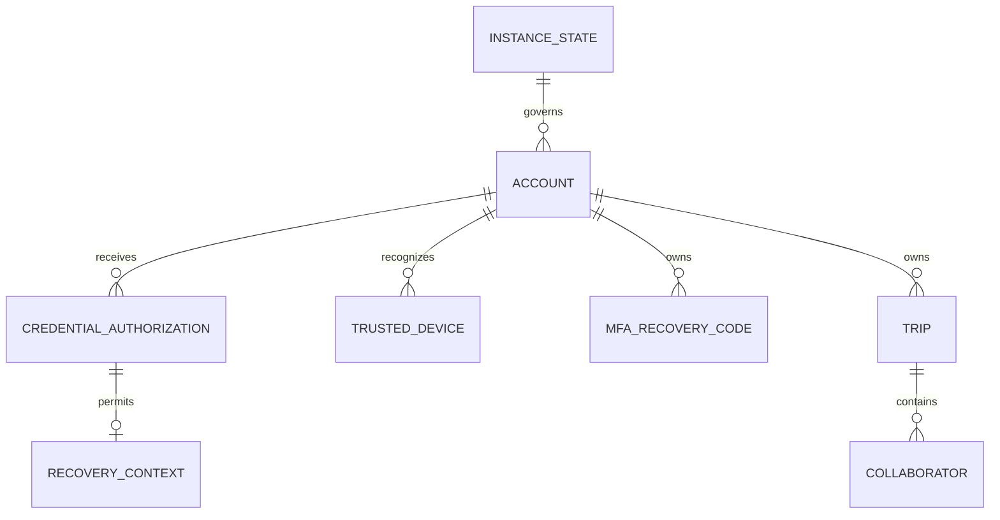

# Architecture Spine — Self-hosted administration

## Design Paradigm

**Layered monolith:** admin screens remain within Arrivo. Web and trusted CLI adapters share account lifecycle rules; persistence owns concurrency. Activity is an optional side effect.

Arrows fix dependency direction. Shared lifecycle services accept explicit caller authority and a transaction executor; they do not import Next.js request APIs. Web wrappers remain server-only. CLI supplies a trusted operator context, never a fabricated signed-in user. Domain types remain in `src/data/types.ts`.

## Invariants & Rules

### AD-1 — Instance authority does not confer trip access [ADOPTED]

- **Binds:** Administration, Overview, account menu, all protected entry points.
- **Prevents:** Stale role claims authorizing actions or admin status exposing private travel data.
- **Rule:** Every admin read and action checks current DB authority; mutation services recheck under transaction locks. Menu visibility and proxy JWT checks are insufficient. Ordinary trip data, files, and live subscriptions retain existing membership checks. Privileged account deletion is a narrow lifecycle operation, not a reusable trip-access bypass. No private trip identities enter deletion confirmations, errors, or accessible markup.

### AD-2 — One durable instance authority governs bootstrap and roles

- **First-run entry (2026-10-27):** `/setup` is instance-admin bootstrap, distinct from later user password-setup links. Server pages read durable initialization on each request before rendering: fresh sign-in and old signup entries redirect to setup; initialized setup/signup entries redirect to sign-in without signup navigation. Missing singleton fails closed and DB failures do not imply a fresh installation. Page checks do not replace the existing transaction lock; stale submissions still cannot create an account. Require server-validated password confirmation. No schema or bootstrap service contract change.

- **Binds:** Bootstrap, upgrade, promotion/demotion, both account-deletion paths.
- **Prevents:** Two first admins, reopened public signup, or concurrent removal of all usable admins.
- **Rule:** One DB instance-state record owns permanent bootstrap completion and retention policy. Serialize bootstrap, role changes, and account deletion on that record. Fresh bootstrap creates first completed admin and marks initialized in one transaction; afterward public signup stays closed regardless of `ALLOW_SIGNUP` or account count. Migration promotes the sole legacy account and marks initialized exactly once; unexpected multiple legacy accounts stop automatic selection with an actionable operator error. Promotion requires completed password setup. Demotion/deletion must leave another completed admin; self-service deletion obeys the same guard. Lock order is instance state, affected users by stable ID, then affected trips by stable ID.

### AD-3 — Account ID and setup state govern access [ADOPTED]

- **Binds:** Add User, setup, sign-in, profile identity, invitations, protected reads/actions.
- **Prevents:** Duplicate accounts, mutable usernames transferring authority, or setup-only access leaking app data.
- **Rule:** Admin creates account immediately with normalized unique username and no password. Account ID binds its setup authorization; regeneration never creates another account. Issuance/regeneration and completion lock account and require unfinished setup; expired links preserve the pending account. Ordinary reset is for completed accounts and cannot bypass first-time setup. Setup completion and password establishment are atomic. Until completion, only validated setup context is admitted: no ordinary Auth.js session, app layout data, protected action, storage read, or live subscription. Link GET never consumes authorization or changes credentials; reopening resumes until original expiry. If another account is signed in, require explicit Sign out and continue, preserve link through sign-out and revalidate it; never silently switch accounts. On completion consume link, then issue ordinary authentication only for that completed account. Existing username normalization and account-ID-bound trip invitations remain authoritative. Setup links and trip invitations are separate domains.

### AD-4 — Purpose-bound random authorizations share one lifecycle [ADOPTED]

- **Binds:** Setup, ordinary password reset, CLI recovery, browser completion.
- **Prevents:** Plaintext link recovery from DB, cross-purpose use, replacement races, or reuse of already-open flows.
- **Rule:** Use cryptographically random tokens with at least 256 bits of entropy; persist only hashes plus account ID, purpose, expiry, and invalidation state. Setup expires after 24 hours; reset and CLI recovery after one hour. Same-purpose issuance invalidates previous authorizations atomically. Every read/submit revalidates context against current DB state; successful completion conditionally consumes authorization under account lock. Deletion invalidates all account authorizations. Completing either reset purpose invalidates every outstanding reset/recovery authorization, including exchanged browser contexts. Recovering by account ID never accepts substituted username. Link URLs are shown only at issuance; lost results require replacement.

### AD-5 — Credential replacement is atomic and distinct from Activity [ADOPTED]

- **Binds:** Reset, CLI recovery, MFA/profile security, session revocation.
- **Prevents:** Partial recovery, lingering trusted sessions, or abandoned attempts modifying active MFA.
- **Rule:** Generating/opening recovery links changes no active credential or session. Ordinary reset replaces password while preserving MFA. CLI completion requires new password and verified replacement MFA; pending secret belongs to recovery authorization, not active or profile-enrollment MFA fields. In one account-locked transaction, revalidate authorization, replace applicable credentials, increment existing `session_version`, revoke trusted devices, invalidate outstanding reset/recovery authorizations, and replace MFA recovery-code hashes for CLI recovery. Failed/expired attempts change none of those. Serialize competing credential changes on the same account. Unfinished authentication proofs, including password-to-MFA sign-in tickets, bind the account security version and cannot establish a session after that version changes. Return new recovery codes once using existing Copy/Download/acknowledgment flow; acknowledgment does not postpone revocation. Both recovery paths return to fresh sign-in; setup completion alone may grant initial app access. Existing session policy remains the revocation authority.

### AD-6 — Recovery CLI is an adapter, not a credential bypass

- **Binds:** Runtime image, trusted operator commands, recovery services.
- **Prevents:** CLI and browser policies diverging or old tooling clearing MFA before recovery completes.
- **Rule:** Package recovery issuance in the existing image. Command takes normalized username and explicit browser-facing base URL, resolves stable account ID, and requires current completed admin at issuance and completion. It emits one replacement recovery URL without changing credentials. Replace the shipped immediate `mfa-reset` behavior and corresponding documentation; do not retain a competing immediate-clear command. CLI shares lifecycle rules through request-independent modules, owns/closes one DB connection, and does not require entrypoint-generated auth/encryption secrets for issuance. Browser completion uses app-loaded encryption key. Operator identity in Activity is explicit CLI/operator context, not the targeted admin as authenticated actor.

### AD-7 — Deletion owns succession and shares concurrency rules

- **Binds:** Admin deletion, self-service deletion, trip creation and membership/ownership writers.
- **Prevents:** Different successor choices, cascade loss of retained trips, or stale confirmation applying changed outcomes.
- **Rule:** Shared lifecycle transaction locks account and affected trips before resolving outcomes. Admin deletion selects remaining account-backed managers first, otherwise editors; within tier use `addedAt` ascending, then user ID ascending. Winner becomes owner, manager, and sole creator. Only viewers or no eligible accounts means delete trip. Self-service retains explicit transfer/delete choices. Recheck confirmation's opaque outcome fingerprint under locks; changed outcomes require renewed review without private details. Cancel sent trip invitations, remove memberships, invalidate authorizations, then delete account. Trip creation shares owner-account lock; membership/ownership mutations share trip lock. File cleanup and live notifications occur after commit; cleanup failure cannot undo deletion. Retained Activity has no account/trip cascade dependency.

### AD-8 — Activity is best effort and never gates actions [ADOPTED]

- **Binds:** Every Activity producer, authentication, CLI, retention cleanup.
- **Prevents:** Logging failures blocking sign-in, credential recovery, or primary mutations.
- **Rule:** Never include Activity writes in primary mutation transaction or await them on web response path. Capture minimal actor/outcome context; schedule successful mutation events only after commit with bounded, caught post-response `after` work. Capture failed sign-in outcomes at credentials gate, including direct callback requests; log no intermediate MFA challenge as completed sign-in. Scheduling, persistence, and cleanup failures cannot change primary response/outcome. CLI logging is bounded and isolated from issuance success/exit status. No mandatory outbox, durable delivery, or retries; shutdown loss and gaps are accepted. Activity counts are informational, not proof of security completeness.

### AD-9 — Activity persists minimal historical identities [ADOPTED]

- **Binds:** Producers, Activity storage/readers, Overview recent activity, account deletion.
- **Prevents:** Renames rewriting history, deleted accounts erasing history, or permissions changes exposing private trip content.
- **Rule:** Store stable account ID and event-time username snapshot for known identities; display snapshot after rename/deletion. Failed sign-ins distinguish matched target account from authenticated actor; unknown usernames retain supplied text marked Unknown account. Missing identity stays unavailable. Trip events store only actor, action, timestamp(s), and trip ID, even for admins with sharing access. No trip titles, destinations, changed values, or collaborator names. Security/admin events may identify affected account by ID and username snapshot but never credentials, tokens, URLs, MFA secrets, or recovery codes. Do not collect/display source IP in Activity. Existing authentication IP throttling is outside this change. Trip links, if offered, require independent current membership.

### AD-10 — Routine edits are persisted as summary batches [ADOPTED]

- **Binds:** All routine trip-edit producers, Activity filters, retention.
- **Prevents:** Per-edit retention, incompatible batching, or asynchronous updates losing newer summary times.
- **Rule:** Persist only batch interval, actor identity snapshot, trip ID, and Updated trip type/action; no underlying edit records or detail payloads. Partition by actor account ID, trip ID, and event-time username value. Only equal username snapshots can merge; renaming back to an earlier username may rejoin its batch within inactivity window. No identity-revision counter or optional rename-log dependency. Connect same-snapshot edit intervals separated by at most ten minutes; concurrency-safe aggregate updates use captured occurrence times, not callback execution time. Delayed arrivals merge connected intervals atomically. Different actors/trips never merge; security/admin events remain individual. Ongoing rows are readable before window closes. Sort by latest event descending with stable ID tie-break; date filters select interval overlap. No live feed or expansion.

### AD-11 — Retention is tolerant, opportunistic physical deletion [ADOPTED]

- **Binds:** Instance policy, maintenance triggers, Activity/Overview queries.
- **Prevents:** Hidden-but-retained records, cleanup under unsaved policy, or mandatory idle-instance scheduling.
- **Rule:** DB policy defaults to 90 days and permits only 30/90/180/365. Shortening requires UX confirmation; save policy before scheduling cleanup. Dynamic app activity and successful policy saves trigger bounded post-response cleanup guarded by a dedicated nonwaiting DB lease/try-lock, separate from primary instance/account/trip locks. Maintenance reads saved policy without locking instance state and locks only maintenance/Activity rows; failures never affect user action. Use saved policy at cleanup time. Delete individual rows or entire batches whose latest event precedes cutoff; keep overlapping batches whole. Expired history stays visible until physically removed. No dedicated scheduler or cleanup guarantee while idle. Policy saved and cleanup complete remain distinct outcomes.

### AD-12 — Overview measures through existing boundaries

- **Binds:** Overview metrics, storage adapter, deployment and operational envelope.
- **Prevents:** Invented healthy/zero results, filesystem access in routes, or new infrastructure required for admin screens.
- **Rule:** Admin-only reads return independently measured values with per-metric freshness and Unavailable failures. User counts distinguish completed admins and pending setup; DB health and storage health are separate probes. Storage adapter owns health and usage measurement. Usage means actual bytes of user-upload storage, excluding transient probes; never infer host capacity or DB size. Runtime remains existing app container plus PostgreSQL and persistent storage volume; no new service/provider, mail integration, or proxy configuration for Activity. Generated migrations run through existing serialized startup migration path; dev and E2E retain separate databases/storage/build caches. No startup promotion runs from a page render.

## Consistency Conventions

| Concern | Convention |
| --- | --- |
| Data ownership | Account lifecycle owns account readiness, admin role, credential authorizations and revocation. Instance state owns bootstrap/retention. Trip ownership and collaborator membership remain existing domain. Activity owns copied minimal snapshots only. |
| Time | ISO 8601 UTC at service boundaries; durations in minutes. Server security, expiry, batching and retention use real server time through injectable clock, as existing authentication does; simulated itinerary date never alters authorization. UI displays local timezone per UX. |
| Transactions | Shared account lock for credential transitions; instance lock before users before trips where applicable. Existing web DB singleton; no hidden second web connection. Deadlocks/serialization failures roll back with bounded retry or explicit retry response, never partial completion. |
| Mutation results | Reconcile unknown results from authoritative state before retry. Setup/link replacements expose only expiry/state after result is lost, never token retrieval. Mutation services return safe results; adapters own redirects, revalidation and notifications. |
| Public credential routes | Separate setup/recovery routes outside authenticated app layout, explicit proxy allowlist, limited authorization cookie/context, CSRF-protected completion. No raw token in analytics or application logs; scrub query from browser after exchange, use no-store and no-referrer responses. |
| Credential validation | Setup, reset, recovery and profile changes share server-enforced password policy. Preserve existing password rules and account/purpose throttles; replacement-MFA verification uses existing failure-budget semantics. Invalid authorization receives generic rejection without expensive credential work. Throttling remains primary security enforcement, independent of optional Activity. |
| URL origins | Recovery/setup links use configured trusted app origin; CLI may supply explicit operator-selected origin. Never construct credential links from unvalidated Host or forwarded headers. Preserve explicitly configured HTTP origins for trusted LAN installations; use HTTPS for public access. Cookies follow configured transport: Secure over HTTPS, HttpOnly and SameSite protections on both. No proxy required for LAN use. |
| UI | Final DESIGN.md/EXPERIENCE.md own shared account menu, responsive sections, mandatory setup dialog, Table and accessibility. Architecture overrides below govern Activity storage and retention. |

## Structural Seed

Activity references copied identifiers and snapshots without deletion cascades. Entity names above are conceptual; code owns table/column detail. Shared lifecycle modules sit under `src/lib/`; web adapters stay beside routes; CLI packaging stays with existing DB/operator tooling. Storage capabilities extend `StorageAdapter` rather than bypassing it.

Existing baseline, verified against lockfile/container definitions on 2026-10-24: Next.js 16.2.4, Auth.js `next-auth` 5.0.0-beta.31, Drizzle ORM 0.45.2, postgres JS 3.4.9, Node 22 and PostgreSQL 17. Retain versions; this spine is not an upgrade request. [Post-response work](https://nextjs.org/docs/app/api-reference/functions/after), [transaction semantics](https://orm.drizzle.team/docs/transactions), [PostgreSQL 17 locks](https://www.postgresql.org/docs/17/explicit-locking.html), [OWASP recovery guidance](https://cheatsheetseries.owasp.org/cheatsheets/Forgot_Password_Cheat_Sheet.html), and [CLI environment behavior](https://docs.docker.com/reference/cli/docker/container/exec/) were checked alongside existing code and version-matched local Next.js docs. Detailed evidence/rationale stays in memlog.

## UX Reconciliation

Architecture coaching supersedes these UX details: no Activity IP field; logging failure never gates actions; routine edits retain summaries only; all trip Activity uses minimal metadata; usernames are historical snapshots; expired records stay visible until opportunistic cleanup; unfinished accounts cannot become admins. Remaining final UX outcomes stay binding.

## Deferred

- Exact route/file/table names, event-type enum members, safe response shapes, and SQL indexes: choose once in feature specs before independent implementations share them; this spine binds ownership and semantics.
- Numeric cleanup cadence/batch size and Activity work timeouts: set together in Activity implementation, bounded without user-response dependency; no scheduled-job requirement.
- Overview query/cache/probe algorithms: choose behind read/storage boundaries; UI requires accurate units, independent freshness and failures.
- Multi-account legacy admin selection, queues, tamper-evident audit, diagnostic logs, backup integration, additional storage providers, suspension and quotas: outside approved first release; revisit only with new requirements.
- Test file/scenario inventory and rollout steps: downstream implementation plans must cover concurrency, setup-only route/action isolation, expired/replaced/competing recovery, no-block Activity failures, privacy, succession and opportunistic retention using repository test-first gates. This document is architecture, not an implementation plan.
