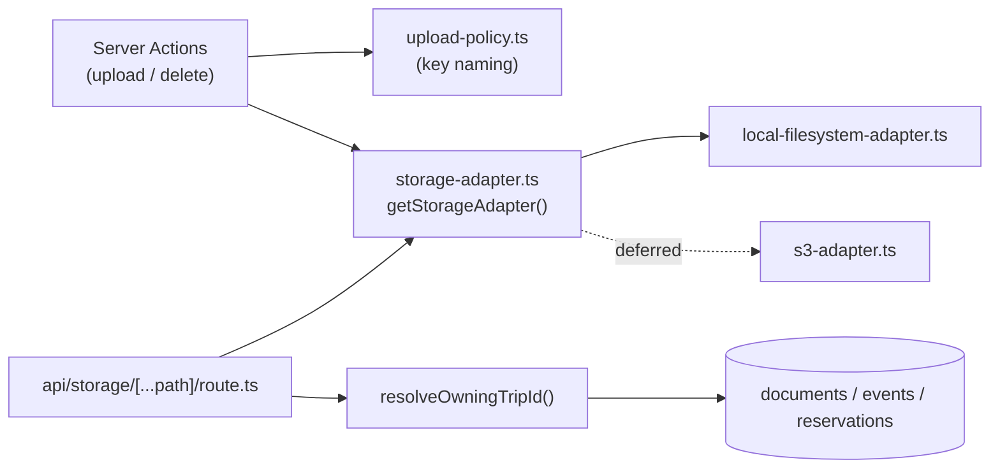
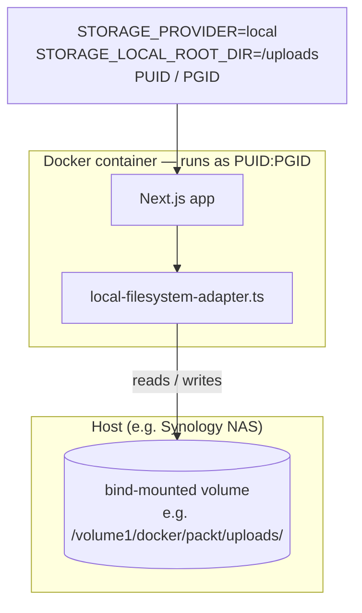

# Architecture Spine — packt-storage-adapter

## Design Paradigm

Strategy pattern behind a single port. `StorageAdapter` is the port; concrete backends (`local-filesystem-adapter.ts`, later `s3-adapter.ts`) are strategies selected at process start via `STORAGE_PROVIDER`. This is scoped to one subsystem, at the same weight as the existing DB-mapper-layer convention — not a whole-app hexagonal restructuring.

Layer map:

- **Port** — `src/lib/storage/storage-adapter.ts`: interface + `getStorageAdapter()` resolver.
- **Strategies** — `src/lib/storage/local-filesystem-adapter.ts` (default), `src/lib/storage/s3-adapter.ts` (deferred).
- **Domain (unchanged)** — `src/lib/upload-policy.ts`: key naming, MIME/size validation. Never moves into the port.
- **Call sites** — server actions (write) and one proxy route (read), never a backend SDK directly.

## Invariants & Rules

### AD-1 — All file I/O goes through the StorageAdapter port

- **Binds:** every upload/delete/read path for documents & cover images (currently 6 action files: `document-upload-actions.ts`, `cover-upload-actions.ts`, `reservation-document-actions.ts`, `trips/[tripId]/actions.ts`, `trips/actions.ts`, `reservations/actions.ts`)
- **Prevents:** the hand-rolled `UPLOAD_STUB` branching duplicated per call site today (each file re-implements the same local-vs-blob if/else, with slightly different comments and error handling)
- **Rule:** No call site imports `@vercel/blob`, `node:fs`, or any backend SDK directly. All I/O goes through `getStorageAdapter()`. Interface:
  ```ts
  interface StorageAdapter {
    put(key: string, file: File): Promise<string>; // returns render-ready URL
    del(url: string): Promise<void>; // parses its own key back out of the url; no-ops if url isn't one it produced (AD-4)
    read(key: string): Promise<ReadableStream>; // Web ReadableStream (fetch/Response-compatible), not Node's Readable — a node:fs-backed adapter must convert via Readable.toWeb()
  }
  ```

### AD-2 — Key naming stays a domain concern; adapters are byte-opaque

- **Binds:** `upload-policy.ts`, every `StorageAdapter` implementation
- **Prevents:** adapters coupling to trip/event/reservation concepts, or key-naming logic duplicating inside an adapter
- **Rule:** Storage keys are generated exclusively by `createUploadStorageName()` in `upload-policy.ts` (`{scope-prefix}/{ownerId}/{uuid}.{ext}`). Adapters treat a key as an opaque path string and never construct or interpret its semantics.

### AD-3 — DB stores a ready-to-render URL, not a bare key `[ADOPTED]`

- **Binds:** `documents.url`, `trips.coverImageUrl`, every adapter's `put()`
- **Prevents:** a future key-to-URL resolver layer being invented for render time
- **Rule:** `put()` returns the final URL consumers render as-is (plain `` or `next/image` with `unoptimized` — both already in use today — neither needs a `remotePatterns` allowlist). The local adapter returns a proxy path built by mapping the key's `/`-separated segments 1:1 onto the `[...path]` catch-all route segments (`/api/storage/<scope-prefix>/<ownerId>/<uuid>.<ext>`) — no additional percent-encoding, since every key segment (scope prefix, uuid, extension) is already URL-safe. Other adapters return their own URL shape. `del(url)` must parse the key back out of the URL it produced — there is no separate key column.

### AD-4 — Single active backend; `del()` is unconditionally safe to call

- **Binds:** `del()` cleanup paths, backend-switch procedure
- **Prevents:** per-file backend tracking, dual-read logic, and the `isBlobUploadUrl()`-style per-call-site ownership check proliferating across adapters
- **Rule:** Exactly one backend is active at a time via `STORAGE_PROVIDER`. `del(url)` is always safe to call unconditionally at any call site — no more `isXUploadUrl()` pre-checks in action files (this absorbs today's `isBlobUploadUrl()` gate, needed because `trips.coverImageUrl` can also come from stock-photo search, a derived graphic, or a direct Mapbox call, not just an adapter upload). Each adapter's `del()` first checks whether the given URL matches its own produced-URL shape; if not recognized, it no-ops rather than attempting deletion or throwing. Deletion failures on a URL the adapter *does* recognize are still best-effort/swallow-and-warn, matching the existing pattern — this is deliberately different from `put()`'s fail-loud behavior (AD-8): a blocked delete must never block the primary DB operation it's cleaning up after. Files left behind by a since-abandoned backend are tolerated as orphans until a future migration script runs (Deferred).

### AD-5 — Local-adapter reads are proxied and trip-scoped-auth-gated

- **Binds:** `src/app/api/storage/[...path]/route.ts`, `local-filesystem-adapter.ts`
- **Prevents:** today's no-auth-on-the-file-itself gap (Vercel Blob URLs are public-by-obscurity) surviving into the new default backend
- **Rule:** The proxy route resolves the owning `tripId` via the shared resolver (AD-6) and calls `requireUser()` + `assertTripAccess()` before streaming bytes via `adapter.read(key)`. No direct filesystem path is ever handed to the browser. This requirement is local-adapter-specific — see Deferred for S3's read/auth posture.

### AD-6 — One shared key→tripId resolver, never reimplemented per call site

- **Binds:** the proxy route's auth check; existing write-side actions that already do this lookup
- **Prevents:** a third copy of the `getEventTripId`/`getReservationTripId`-style lookup appearing in the route handler, alongside the two that already exist independently in `document-upload-actions.ts` and `reservation-document-actions.ts`
- **Rule:** One resolver — `resolveOwningTripId(key: string): Promise<string>` — is the only place that parses a storage key's scope-prefix (`trip-documents`, `event-documents`, `reservation-documents`, `trip-covers`) back to an `UploadScope`, extracts the ownerId segment, and maps it to a `tripId` (direct for `trip-cover`/`trip-document`; via event/reservation lookup otherwise). It owns the entire reverse-parse — no caller pre-parses scope/ownerId itself. It throws (never returns `null`/`undefined`) on a malformed key or a missing owning record, so a caller can never pass a falsy `tripId` into `assertTripAccess()`. All call sites, read and write, import it from one module rather than re-deriving any part of this mapping.

### AD-7 — Adapter resolution is a lazily-validated singleton

- **Binds:** `getStorageAdapter()`
- **Prevents:** per-call adapter instantiation; missing-env-var failures surfacing deep inside an unrelated `put`/`del` call instead of at the point of misconfiguration
- **Rule:** Mirrors `src/db/index.ts`'s `globalThis.__pgClient` pattern exactly, including its `NODE_ENV !== "production"` gating: the resolved adapter is cached on `globalThis` outside production only (surviving Next.js dev hot-reload without leaking instances), and constructed fresh per process in production (where the module only loads once anyway). `getStorageAdapter()` validates the env vars required by the selected `STORAGE_PROVIDER` on first resolution per process and throws a clear "missing X env var" error at that point. Per-provider secrets (S3 access keys, etc.) are supplied via env vars only — never committed to git, never baked into the container image (Must-scope requirement from the brainstorm).

### AD-8 — Local adapter's `put()` fails loudly on permission errors

- **Binds:** `local-filesystem-adapter.ts`'s `put()` (write path only — see AD-4 for `del()`'s separate, deliberately-tolerant failure handling)
- **Prevents:** PUID/PGID-vs-bind-mount ownership mismatches (`EACCES`) on the write a user is actively waiting on being silently swallowed or surfaced as a generic error — invisible in dev, discovered only in production
- **Rule:** `EACCES`/`EPERM` errors from `put()`'s filesystem write are caught and re-thrown with an explicit message naming the path and pointing at a PUID/PGID mismatch as the likely cause, so the upload visibly fails for the user instead of appearing to succeed. This does not apply to `del()` (AD-4).

### AD-9 — Content-Type contract for reads

- **Binds:** `local-filesystem-adapter.ts`'s `read()`, the proxy route
- **Prevents:** broken inline rendering for the exact formats this app supports (HEIC/AVIF images, PDFs) because the browser receives bytes with no or a generic `Content-Type`
- **Rule:** The proxy route sets `Content-Type` on its `Response` by reverse-looking-up the key's file extension against `upload-policy.ts`'s existing extension↔MIME table (extended with a reverse map) — not by asking the adapter; `read()` returns raw bytes only, no metadata. `Content-Disposition: inline` is set so documents/images render in place rather than force-downloading.



## Consistency Conventions

| Concern                                                         | Convention                                                                                                                                                                          |
| ---------------------------------------------------------------- | ------------------------------------------------------------------------------------------------------------------------------------------------------------------------------- |
| Naming (entities, files, interfaces, events)                    | `put`/`del`/`read` method names fixed by the `StorageAdapter` interface. Storage keys: `{scope-prefix}/{ownerId}/{uuid}.{ext}`, built only by `createUploadStorageName()`.        |
| Data & formats (ids, dates, error shapes, envelopes)             | `documents.url` / `trips.coverImageUrl` are render-ready URL strings, backend-opaque to every consumer. No separate key column anywhere.                                          |
| State & cross-cutting (mutation, errors, logging, config, auth) | `STORAGE_PROVIDER` env selector; `getStorageAdapter()` is a lazy-validated singleton; `del()` is best-effort/swallow-and-warn on recognized URLs, no-op on unrecognized ones; proxy route always auth-gates before streaming. |
| Test environment (E2E)                                          | `playwright.config.ts`'s webServer env replaces `UPLOAD_STUB: "true"` with `STORAGE_PROVIDER=local` + `STORAGE_LOCAL_ROOT_DIR` pointed at an E2E-scoped scratch directory — E2E exercises the real local adapter, not a parallel stub. |
| Import enforcement                                               | AD-1's ban is enforced via an eslint `no-restricted-imports` rule: `@vercel/blob` disallowed everywhere (the dependency is removed once cutover completes), `node:fs`/`node:fs/promises` disallowed outside `local-filesystem-adapter.ts`. |

## Stack

| Name                        | Version                          |
| ---------------------------- | --------------------------------- |
| `node:fs/promises`            | Node.js built-in — already used by `local-upload.ts` today, no new dependency for Must-scope |

S3-compatible adapter's SDK (e.g. `@aws-sdk/client-s3`, works against MinIO/B2/R2 via endpoint override) is not pinned here — verify current version when that Should-scope adapter is actually built.

## Structural Seed

```text
src/
  lib/
    storage/
      storage-adapter.ts            # StorageAdapter interface + getStorageAdapter()
      local-filesystem-adapter.ts   # default adapter (PUID/PGID + bind mount target)
      trip-resolution.ts            # resolveOwningTripId() shared by read + write paths
    upload-policy.ts                # unchanged: key naming, MIME/size validation
  app/
    api/
      storage/
        [...path]/
          route.ts                  # proxy read: auth-gate via resolveOwningTripId + adapter.read()
```

Deployment target (self-hosted Docker — the reason this design exists):



## Deferred

- **S3-compatible adapter** (Should, not this round) — covers AWS S3, MinIO, Backblaze B2, Cloudflare R2 via one adapter. Its read/auth posture (proxied-through-app like local, vs. direct external URL from a public bucket) is decided when it's actually built — AD-5's auth-gated-proxy requirement binds the local adapter only.
- **Migration script** — no legacy data exists yet (fresh cutover from Vercel Blob, not a migrate-in-place). Deferred until real data needs to move between backends; verify-then-cutover approach, no dual-read.
- **Image resize/optimization** — unrelated to the storage abstraction; current no-processing behavior stays as-is.
- **Vercel Blob adapter** — not building one. Production cuts over from Vercel hosting to self-hosted Docker as part of this effort, so Vercel Blob's prod use simply stops; the S3-compatible adapter would cover the same need if ever wanted later.
- **Orphaned files across a backend switch** — tolerated, not solved (ties to the deferred migration script). Redeploy-to-switch is acceptable; live-switching is not a requirement.
- **`STORAGE_LOCAL_ROOT_DIR` and other per-provider env var names** — seed-level naming, owned by the code once `local-filesystem-adapter.ts` exists; not worth fixing further here.
- **Docker entrypoint / PUID-PGID remap plumbing** (chown, `gosu`/`su-exec`, or an s6-overlay-style init) — a separate containerization effort, not this spine's job. This spine only ensures `local-filesystem-adapter.ts`'s code never assumes it's running as root and fails loudly on a permission mismatch (AD-8); the container image/entrypoint that actually drops privileges to PUID:PGID is designed when that containerization work happens.
