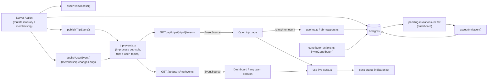
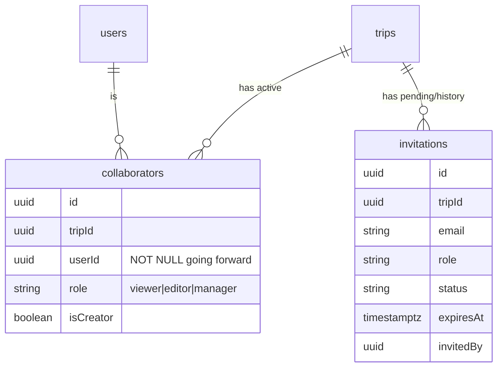

# Architecture Spine — trip-contributors

## Design Paradigm

Every mutation still flows through the existing server-action command layer (`requireUser()` → `assertTripAccess()` → write → `revalidatePath()`). This spine adds one new concern on top: a one-way **notification side-channel** — after a mutation commits, the action publishes a change event to a per-trip and/or per-user topic; an SSE stream fans it out to every open session subscribed to that topic. The side-channel never carries the mutation itself and is never the source of truth — a client that misses an event still sees correct state on next navigation/refetch/reconnect, because Postgres via `assertTripAccess()`-gated queries remains authoritative.

Invitations require a matched Packt account at send time (SPEC constraint) — there is no email delivery and no public acceptance route. This keeps the whole feature inside the existing authenticated app shell: no token/crypto infrastructure, no SMTP dependency, no unauthenticated-session branching.

Layer map:

- **Command layer (existing, extended)** — server actions in `trips/[tripId]/*actions.ts` and `trips/actions.ts`; every write still goes through `assertTripAccess()` (or, for invitation acceptance, `requireUser()` plus an email match check — see AD-5).
- **Invitation domain (new)** — `src/lib/invitations.ts`: issuance, expiry, state transitions, resend, rescind, and the pending-invitations lookup. Never called from a client component directly.
- **Notification side-channel (new)** — `src/lib/trip-events.ts` (in-process publish/subscribe over two topic kinds, `trip:{tripId}` and `user:{userId}`) + two SSE routes fanning each out. Read-only signal; carries no write authority.
- **Sync status (new)** — `src/lib/use-live-sync.ts` + `src/components/packt/sync-status-indicator.tsx`: the client-side connection-state surface both SSE routes drive.

## Invariants & Rules

### AD-1 — `manager` replaces `owner` as the top collaborator rank; the creator is marked, not ranked, separately

- **Binds:** CAP-5, CAP-6, `collaborators.role`, `assertTripAccess()`, every existing role-check call site, `trip-edit-collaborators.tsx`
- **Prevents:** a parallel 4th rank, or a second "who's really in charge" source of truth drifting from `trips.ownerId`
- **Rule:** `collaborators.role` values become `viewer | editor | manager` (was `viewer | editor | owner`); `assertTripAccess(tripId, userId, minRole)` takes the same three values, rank `viewer=0, editor=1, manager=2`. Add `collaborators.isCreator: boolean`, `true` for exactly one row per trip — the user in `trips.ownerId`. Only the `isCreator` row is non-removable and non-demotable; every other `manager` row is a full peer, removable/demotable by the creator or by another manager. Existing rows with `role='owner'` are data-migrated to `role='manager', isCreator=true` as part of this cutover — no dual-read period.

### AD-2 — Invitations are a separate table; `collaborators` holds only real, accepted membership

- **Binds:** CAP-1, CAP-2, CAP-6, CAP-7, CAP-11
- **Prevents:** one table conflating pending and active membership, and today's dead-`userId` half-built state (`addCollaborator()` never sets `userId`) from persisting into the real feature
- **Rule:** New `invitations` table: `id, tripId, email, role, status(pending|accepted|declined|expired|rescinded), expiresAt, invitedBy, createdAt`, unique on `(tripId, email)` where `status='pending'`. Because an invitation is only ever created for an email matching an existing Packt account (AD-5), no token/hash column is needed — the row itself is the invite; visibility and acceptance are both scoped by matching `session.user.email` to `invitations.email`, never by a bearer token. A `collaborators` row is created **only** on acceptance, and `userId` is `NOT NULL` from that point forward — no more nullable-`userId` rows. The share dialog's "active" list reads `collaborators`; its invitations list reads `invitations WHERE status IN ('pending', 'declined')` — a declined row stays visible to the manager (CAP-6, CAP-11) until they dismiss it (`dismissInvitation(invitationId)`, a hard delete, valid only for non-`pending` rows) or re-invite the same email, which inserts a **new** row (the partial unique index only covers `status='pending'`, so a prior `declined`/`expired`/`rescinded` row never blocks a fresh invite). **Resend** (pending rows only) resets `expiresAt` to `now() + 72h` (there is no token to rotate). **Inviting an email that already has a pending invitation for that trip is treated as an implicit resend** (same row, reset expiry, role updated to the newly-specified value) — never a duplicate row, never an error. Expired and rescinded rows are not surfaced this way — they simply stop appearing once no longer `pending`, matching the manager's own action (rescind) or a passive timeout neither side needs a persistent record of.

### AD-3 — Live sync is a one-way SSE side-channel over two topic kinds, never a write path

- **Binds:** CAP-8, CAP-9
- **Prevents:** WebSocket's heavier footprint (a custom server or separate service, unneeded here since every write already goes through server actions); polling's weaker freshness guarantee; and a per-trip-only channel leaving the dashboard and any other open session blind to a removal that just happened to them
- **Rule:** Two SSE routes, both Route Handlers returning `text/event-stream`:
  - `GET /api/trips/[tripId]/events` — gated by `requireUser()` + `assertTripAccess(tripId, userId, "viewer")`. Streams itinerary/day/event change notifications and `membership-changed` to anyone with that trip page open.
  - `GET /api/users/me/events` — gated by `requireUser()` only (it is the caller's own channel). Streams `membership-changed`/`membership-removed` scoped to that user, across every trip, so the dashboard and any other open session reflect a role change or removal without needing that specific trip's channel open.

  Clients never write through either connection. Both send a periodic heartbeat comment; a client's `EventSource.onerror`/reconnect-backoff state drives the status-bar offline indicator (CAP-8, AD-8). **Reconnect resync:** `onopen` firing after any reconnect (not just the initial connect) triggers a full refetch of the relevant state — the stream is a best-effort nudge with no gap-filling, so events missed during a disconnect window are recovered only by this resync, never replayed. **Event ordering:** receiving `membership-removed` naming the viewer's own `userId` (on either channel) immediately shows the revocation modal (CAP-9) and short-circuits all further event/refetch processing for that trip — no stale in-flight response can repaint revoked content after the modal renders. Every other client-triggered refetch carries a monotonic request-generation counter; a response is applied only if no newer request has since been issued.

  `membership-removed`'s payload carries `{removedUserId, tripId, tripName, removedByName, removedByEmail}` inline — the removing action already has the acting manager's identity in scope as the authenticated caller performing the removal, so it embeds *their* name/email at publish time, not `trips.ownerId`/the creator's. This is deliberate: under AD-1 any manager, not only the creator, can remove a contributor, and the person a removed contributor should actually contact is whoever made that call — resolving to the creator instead would point them at someone who may have no context on the removal, and this also holds up if a future release lets some other role trigger removal. Once removed, `assertTripAccess()` rejects any query the client could otherwise make to look this identity up after the fact, so the modal relies entirely on the payload captured at publish time, never a fresh fetch.

### AD-4 — Notification fan-out is in-process; horizontal scale is out of scope for this round

- **Binds:** `src/lib/trip-events.ts`
- **Prevents:** premature Redis/pub-sub infrastructure this single-container deployment target doesn't need yet
- **Rule:** `trip-events.ts` holds two `Map<topicId, Set<subscriberCallback>>`s (one for `trip:{tripId}` topics, one for `user:{userId}` topics) on `globalThis` (same singleton shape as `db/index.ts`'s `__pgClient`). A server action calls `publishTripEvent(tripId, event)` and, for membership changes/removal, also `publishUserEvent(affectedUserId, event)` after its write commits; each SSE route's subscriber callback pushes to its own connection. This assumes one running app instance — a multi-instance/cluster-mode deployment would need the Deferred Redis swap. See Deferred.

### AD-5 — Invitation acceptance and decline are authenticated, email-scoped actions; no email delivery, no public route

- **Binds:** CAP-1, CAP-2, CAP-7, CAP-11
- **Prevents:** building token generation/hashing, SMTP delivery, and public-route session-branching (no-session / matched / mismatched) for a case that can't happen once every invite requires a matched account
- **Rule:** `inviteContributor(tripId, email, role)` in `contributor-actions.ts` looks up `users` by email at write time; no match returns a validation error to the share dialog ("No Packt account found for this email") and persists nothing. A matched invite is visible only to that account: `getMyPendingInvitations(userEmail)` in `src/lib/invitations.ts` queries `invitations WHERE email = ? AND status = 'pending' AND expiresAt > now()`, rendered by `src/components/packt/pending-invitations-list.tsx` on the trips dashboard. `acceptInvitation(invitationId)` and `declineInvitation(invitationId)` (both in `trips/actions.ts`) are server actions gated by `requireUser()`, each re-verifying `invitation.email === user.email` server-side (defense in depth even though the list query already filtered), then performing one atomic conditional update — never read-then-write: `UPDATE invitations SET status='accepted'|'declined' WHERE id=? AND email=? AND status='pending' AND expiresAt > now() RETURNING *`. Accept additionally inserts the `collaborators` row only if a row came back; decline needs no follow-up write. Zero rows returned (either action) means the invitation was already resolved (accepted, declined, rescinded, resent/superseded, or expired) between page-load and click — the row simply disappears from the list, no separate terminal-state page to render. Because an invitation is never visible to a non-matching account, the previous "mismatched account" branch and any public token route are structurally eliminated, not just unbuilt. `(app)/layout.tsx` calls `getMyPendingInvitations(user.email)` once (the same function backing the dashboard list, not a parallel count query) and passes its length into `SidebarNav` → the "Trips" `NavItem`'s existing `count` prop, so the invitee sees a badge on every app page, not only after navigating to the dashboard.

### AD-6 — Viewer's financial exclusion threads the resolved role into the existing query call site; no parallel enforcement path

- **Binds:** CAP-3, CAP-4, CAP-5
- **Prevents:** a second, UI-only copy of the money/budget hide-list drifting from the server-enforced one, and a naive per-component check that some money-rendering component forgets
- **Rule:** No new enforcement *layer*, but the mechanism is real and new at two call sites — today `queries.ts`/`db-mappers.ts` do zero role-based filtering. `getTripDetail(tripId, userId)` resolves the caller's role via `assertTripAccess`'s existing lookup, then passes it into `dbTripToType(dbRow, { role })`; that mapper omits `budget`, `budgetTotal`/`budgetPerPerson`, and expense/report data from the returned shape whenever `role === "viewer"`. A component never re-checks role to decide whether to render money fields — if the mapper didn't include the field, there's nothing to render. Second call site: `listExpensesForUserInRange(userId, startDate, endDate)` joins `collaborators` on `userId` with **no role filter today** — every trip the user collaborates on, at any role, feeds their personal Spending/expense-report aggregation (`buildSpendingSummary` in `src/lib/spending.ts`). The join gains `and(eq(collaborators.userId, userId), ne(collaborators.role, "viewer"))`: a trip where the caller is only a viewer is excluded from `tripList` entirely, so it never reaches expense fetch or aggregation — same "nothing to render because nothing was returned" posture as the trip-detail path, not a second UI-level filter. Concurrent itinerary edits (CAP-10) need no new mechanism — plain `UPDATE` writes with no version/optimistic-lock column already produce latest-write-wins; this spine adds none.

### AD-7 — Share dialog Save applies staged changes as one atomic batch

- **Binds:** CAP-6, `contributor-actions.ts`, `trip-share-dialog.tsx`
- **Prevents:** partial-apply leaving the dialog's staged/saved state ambiguous, and two builders picking different granularity (one row-at-a-time action vs. one batch) for a security-sensitive operation
- **Rule:** The dialog's row data — active `collaborators` plus `invitations WHERE status IN ('pending', 'declined')` — comes from `getContributorsAndInvitations(tripId, userId)`, gated by `assertTripAccess(tripId, userId, "manager")` at the query itself, not only at the trigger button. An editor or viewer therefore gets nothing back even if the dialog were somehow opened (URL manipulation, a client bug) — pending/declined invitation emails are exactly the kind of data a UI-only gate would otherwise leak. Save calls exactly one server action, `saveContributorChanges(tripId, changes: ContributorChange[])`, where each `ContributorChange` is a role-change or a removal keyed by collaborator/invitation id. The action applies every change inside a single DB transaction — all staged edits land, or none do. There is no per-row save; Cancel discards all staged client-side state without calling the server. Resend, Rescind, and Dismiss (on a declined row) are **not** staged changes — like today's Resend/Rescind, `dismissInvitation()` fires immediately on click, matching the existing "non-destructive/self-contained, no batch needed" treatment for invitation-row actions distinct from role/removal edits on `collaborators` rows. **The server rejects the entire batch if any `ContributorChange` targets a row with `isCreator=true`**, regardless of what the dialog's UI allowed to be staged (AD-1) — the disabled control in `trip-share-dialog.tsx` is a UX nicety, never the enforcement point. Each `ContributorChange` is applied against an expected-state guard, not an unconditional write: the transaction re-checks the targeted row's current state against what the dialog last loaded (the row still exists and, for a role change, still holds the from-role the dialog staged against) before applying it. If any entry's guard fails — the row was modified by another manager's concurrent save, or deleted, since this dialog last loaded its data — the entire batch is rejected and nothing lands, even the other, unrelated staged changes; the dialog must reload and re-stage. This is a deliberate departure from CAP-10's latest-write-wins posture: unlike a silently-overwritten itinerary field, a demotion or removal that silently no-ops here would leave a manager believing access was revoked when it wasn't — a security-relevant false signal CAP-10's itinerary-edit tolerance doesn't carry.

### AD-8 — A single live-sync hook backs both the status-bar indicator and the dashboard's own live updates

- **Binds:** CAP-8, CAP-9, `src/lib/use-live-sync.ts`, `src/components/packt/sync-status-indicator.tsx`
- **Prevents:** CAP-8's offline indicator being referenced by other ADs without ever having a UI home, and CAP-9's "removed from dashboard/shared-trip list" requirement having no channel to ride on outside an open trip page
- **Rule:** `use-live-sync.ts` is a client hook wrapping one `EventSource` (against `/api/users/me/events` on the dashboard, or both that and `/api/trips/[tripId]/events` on a trip page) and exposing `{status: "connected" | "reconnecting" | "offline"}`. `sync-status-indicator.tsx` renders that status in the app's status bar and is mounted once in `(app)/layout.tsx`, the same tier as the existing single `<Toaster>`. The dashboard subscribes to `user:{userId}` specifically so a `membership-removed` event drops that trip from the shared-trip list immediately, without requiring the trip page to have ever been open.



## Consistency Conventions

| Concern                                                          | Convention                                                                                                                                                                                                          |
| ----------------------------------------------------------------- | --------------------------------------------------------------------------------------------------------------------------------------------------------------------------------------------------------------- |
| Naming (entities, files, interfaces, events)                     | Role values: `viewer \| editor \| manager`. SSE event `type` values: `itinerary-changed`, `membership-changed`, `membership-removed`. Invitation `status`: `pending \| accepted \| declined \| expired \| rescinded`.        |
| Data & formats (ids, dates, error shapes, envelopes)              | `invitations.expiresAt` is a `timestamptz` set to `createdAt + 72h` at insert (global constant, not per-invite input). No token/hash field exists on `invitations` — see AD-2/AD-5.                              |
| State & cross-cutting (mutation, errors, logging, config, auth)  | Every contributor-management action still opens with `requireUser()` + `assertTripAccess(tripId, userId, "manager")`. `acceptInvitation()` opens with `requireUser()` only and re-checks the email match server-side (there is no trip access to check yet at that point). The trip SSE route opens with `requireUser()` + `assertTripAccess` at `minRole: "viewer"`; the user SSE route opens with `requireUser()` only. No SMTP/email env guard is needed — invitations never leave the app. |
| Test environment (E2E)                                            | E2E scenarios materialize their own `invitations`/`collaborators` rows per the project's self-seeding convention — no shared fixture trips, no email stub needed.                                                |

## Stack

No new dependencies for this feature. The SSE side-channel needs no library — a Next.js 16 Route Handler returning a `ReadableStream` with `Content-Type: text/event-stream` is sufficient, and `EventSource` is a browser built-in. Invitation acceptance needs no token/crypto library now that it is authenticated-only (AD-5).

## Structural Seed

```text
src/
  lib/
    invitations.ts          # getMyPendingInvitations(), expiry check, resend, rescind, state transitions
    trip-events.ts          # in-process pub-sub: publishTripEvent(), publishUserEvent()
    use-live-sync.ts         # client hook: EventSource wrapper -> connection status
  app/
    api/
      trips/
        [tripId]/
          events/
            route.ts         # SSE GET: auth-gate + trip:{tripId} topic fan-out
      users/
        me/
          events/
            route.ts         # SSE GET: auth-gate (requireUser only) + user:{userId} topic fan-out
    (app)/
      layout.tsx              # mounts <SyncStatusIndicator/> alongside existing <Toaster/>
      trips/
        actions.ts             # extended: acceptInvitation()
        [tripId]/
          contributor-actions.ts   # invite/resend/rescind/dismissInvitation/saveContributorChanges server actions
  components/
    packt/
      trip-share-dialog.tsx        # replaces trip-edit-collaborators.tsx as the control plane
      pending-invitations-list.tsx # dashboard: invitations addressed to the signed-in user
      contributor-revocation-modal.tsx
      sync-status-indicator.tsx    # status-bar connection state (CAP-8)
```



## Capability → Architecture Map

| Capability | Lives in                                                        | Governed by      |
| ---------- | ---------------------------------------------------------------- | ----------------- |
| CAP-1      | `contributor-actions.ts` (invite), `invitations.ts`               | AD-2, AD-5        |
| CAP-2      | `pending-invitations-list.tsx`, `invitations.ts`, `trips/actions.ts` (`acceptInvitation`) | AD-2, AD-5 |
| CAP-3      | `queries.ts` (`getTripDetail`, `listExpensesForUserInRange`)/`db-mappers.ts`, `assertTripAccess()` | AD-1, AD-6 |
| CAP-4      | `assertTripAccess()`, budget actions                              | AD-1, AD-6        |
| CAP-5      | `assertTripAccess()`, `contributor-actions.ts`                    | AD-1              |
| CAP-6      | `trip-share-dialog.tsx`, `contributor-actions.ts` (incl. `dismissInvitation`, `getContributorsAndInvitations`), `invitations.ts` | AD-1, AD-2, AD-7  |
| CAP-7      | `invitations.ts` (expiry check, rescind)                          | AD-2              |
| CAP-8      | `trip-events.ts`, both SSE routes, `use-live-sync.ts`, `sync-status-indicator.tsx` | AD-3, AD-4, AD-8 |
| CAP-9      | `contributor-revocation-modal.tsx`, `trip-events.ts`, `api/users/me/events`, existing `assertTripAccess()`-triggered `notFound()` | AD-3, AD-1, AD-8 |
| CAP-10     | (no new component — existing plain-write behavior)                | AD-6              |
| CAP-11     | `pending-invitations-list.tsx`, `trips/actions.ts` (`declineInvitation`), `trip-share-dialog.tsx`, `contributor-actions.ts` (`dismissInvitation`) | AD-2, AD-5, AD-7 |

## Deferred

- **Email delivery for invitations (SMTP/nodemailer) and a signup route for unmatched addresses** — deferred; SPEC now requires a matched account at invite time (SPEC Non-goals, Open Questions). Revisiting this needs new token/hashing infrastructure, an SMTP transport, a public accept route with session branching, and SMTP provider selection/deliverability setup (SPF/DKIM) — none of that is designed here.
- **Redis (or equivalent) pub-sub for `trip-events.ts`** — needed only if the deployment target ever runs more than one app instance (including PM2 cluster mode, not just multi-container). AD-4's in-process approach assumes a single process, matching the storage-adapter spine's deployment target.
- **Reverse-proxy SSE buffering** — if a reverse proxy (e.g. nginx) is ever placed in front of the self-hosted container, it must be configured not to buffer the SSE routes (e.g. `X-Accel-Buffering: no`) or the "live" guarantee silently degrades to proxy-buffer-flush intervals. Not designed further here since no proxy sits in front of the current deployment target.
- **Migrating existing `role='owner'` rows** — a one-statement data migration (`UPDATE collaborators SET role='manager', is_creator=true WHERE role='owner'`), not designed further here; it's a migration script detail, not an invariant.
- **Per-invitation or configurable expiry** — SPEC's open question; AD-2's `expiresAt = createdAt + 72h` stays a fixed global constant until that product decision lands.
- **Friend/known-user picker, message center, viewer PDF export** — SPEC non-goals; no architecture surface reserved for them here.
- **Rate-limiting invitation sends** — not addressed; worth a look before this ships publicly, but no capability in SPEC-trip-contributors calls for it yet.
